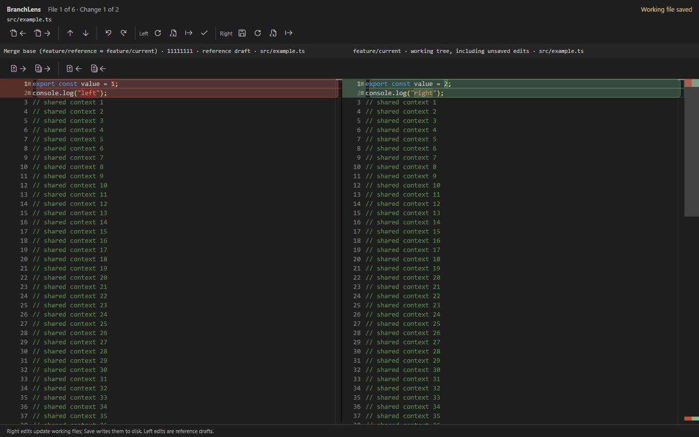
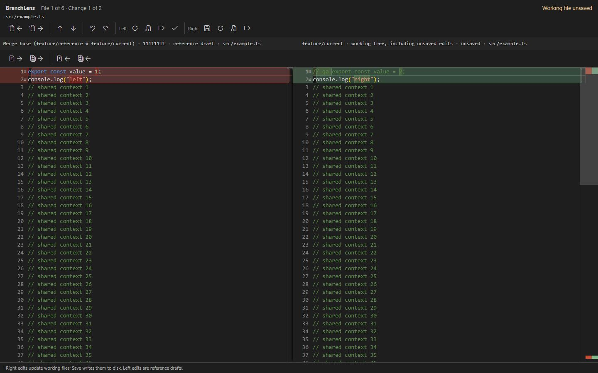

# BranchLens

**Compare your branch. Review each change. Keep editing.**

BranchLens brings branch comparison into VS Code. Choose a reference branch, see what changed in your current checkout, and copy individual lines or complete change sections into your working files. Your staged, unstaged, new, and unsaved changes are included.

## Why BranchLens?

- **Review your work in context.** Browse changed files in a folder tree or flat list, filter by path, and jump between changes.
- **See changes clearly.** Rounded section highlights and inline word differences make edits easy to follow.
- **Move only what you need.** Copy a changed line or a whole section in either direction.
- **Keep working in the comparison.** Edit your current file on the right, then save it with Ctrl+S on Windows/Linux or Cmd+S on macOS.
- **Find tools without a crowded toolbar.** Hover over an icon or focus it with the keyboard to see what it does.

## Get started

Once BranchLens is installed:

1. Open a trusted folder containing your Git repository in VS Code.
2. Select **BranchLens** in the Activity Bar.
3. Choose your **Repository** if more than one is available.
4. Choose a **Reference branch** to compare against, such as `development` or `main`.
5. Click **Compare**, then select a file under **Changed Files**.

The **Current branch** on the right is the branch already checked out in your repository. Selecting a reference leaves your checkout unchanged.

For example, if you are working on `feature/login`, choose `development` as the reference to review your feature changes alongside edits you have not committed or saved yet.

*Screenshots show the BranchLens interface with sample repository data.*

## Understand the two sides

| Side | What you see | What editing does |
| --- | --- | --- |
| **Left — reference preview** | The comparison baseline from your selected reference. | Changes a preview draft. The reference branch and its commits stay unchanged. |
| **Right — current working file** | Your checked-out branch, including local and unsaved edits. | Updates the actual VS Code file buffer. Use Save to write text edits to disk. |

**Edits on the right affect your working file.** This includes typing, copying from the left, Undo, Redo, and Reset. Text edits stay unsaved until you save the file. Explicit create, rename, or delete operations can affect the filesystem immediately; deleting a working file asks for confirmation.

The comparison opens as a reusable panel. You do not need to name or save a comparison-session file. Closing the panel leaves your working-file edits in VS Code, where normal save and backup behavior applies.

## Review and copy changes

1. Select a changed file. Use the previous/next file icons to move through the list.
2. Use the up/down change icons to jump between highlighted sections.
3. Place the cursor on one changed line and choose **Copy selected line**, or choose **Copy entire change section** to transfer the whole block.
4. Choose the direction: **Left to Right** updates your working file; **Right to Left** updates the reference preview.
5. Review the result and save the working file when ready.

Copying replaces the matching destination content and keeps the source. If a line cannot be matched unambiguously, BranchLens asks you to copy the whole section instead. A complete added or deleted section can also create or remove a file.

**Undo** and **Redo** let you revisit comparison edits. **Reset** restores the chosen side to its content when the file was opened in the comparison, after confirmation. Hover or keyboard-focus any toolbar icon for its description and available shortcut; press Escape to dismiss the tooltip.

### Change highlighting

Use **Highlight change sections** to show or hide the rounded section backgrounds and inline word highlights. An insertion or deletion with no lines on one side appears as a dashed boundary.

### Save your work

The **Working file unsaved** label means the current file has pending text changes. Click the Save icon or press Ctrl+S / Cmd+S to save that file. Saving does not commit your changes.

## Choose what to compare

**Include upstream changes** controls the baseline on the left:

| Setting | Comparison | Use it to… |
| --- | --- | --- |
| **Off** | The common ancestor of the reference and your current branch → your working files. | Review changes on your branch since it diverged, including your local edits. |
| **On** | The latest locally available reference commit → your working files. | See all differences from the reference, including changes made only on that reference. |

BranchLens uses local branches and locally available remote-tracking references. It does not fetch automatically. To compare against newer remote changes, fetch using your usual Git tools, then **Refresh** the comparison.

## Export or apply a reference preview

Use **Export patch** to save edits from either side as a Git-compatible patch, relative to that side's opening content.

If you edit the left preview and want those edits in another checkout, use **Apply reference draft** and explicitly choose a local branch/worktree. A worktree is a separate folder checked out to a branch. BranchLens checks the destination before applying and asks you to resolve conflicting content. Save text changes in that destination when ready.

Reference preview drafts are recovered automatically for the workspace and current branch. If changing the comparison would replace a modified preview, BranchLens asks first.

## Keyboard shortcuts

These defaults apply while the BranchLens comparison panel is active. You can change them in VS Code's **Keyboard Shortcuts** editor by searching for `BranchLens`.

| Action | Shortcut |
| --- | --- |
| Save current working file | Ctrl+S / Cmd+S |
| Next / previous file | Alt+Shift+PageDown / PageUp |
| Next / previous change section | Alt+Shift+Down / Up |
| Copy selected line Left → Right / Right → Left | Alt+Shift+Right / Left |
| Copy section Left → Right / Right → Left | Alt+Shift+L / R |
| Focus left / right editor | Alt+Shift+1 / 2 |
| Focus changed files | Alt+Shift+F |
| Toggle upstream comparison | Alt+Shift+U |
| Refresh comparison | Alt+Shift+C |
| Undo / redo comparison edit | Ctrl+Z / Ctrl+Shift+Z; macOS: Cmd+Z / Cmd+Shift+Z |

## Requirements and supported files

- **VS Code 1.95 or newer**, with Git installed and available on your system PATH.
- A **trusted workspace** with a local Git working tree. Virtual workspaces are not supported.
- **UTF-8 text files up to 2 MiB per side**, using consistent LF or CRLF line endings. Files without a final newline are supported.

Binary files, Git LFS pointers, symlinks, submodules, invalid UTF-8, mixed line endings, and oversized files display an unsupported-file message. Permission changes and case-only renames on Windows are not supported. The comparison editor provides syntax highlighting; full language-server features from the normal VS Code editor are not available inside it.

## Common questions

**Why is my repository missing?**

Open its folder in VS Code, or add it as a workspace folder. Automatic discovery searches up to four directory levels and skips dependency and build folders.

**Why is my remote branch missing or out of date?**

Fetch it with your usual Git tools, then Refresh. BranchLens only uses references and Git objects already available locally.

**Why are there no changed files?**

Clear the path filter and check your reference and upstream setting. Your files may already match the selected baseline. A file whose differences were resolved can remain open for Undo while disappearing from the changed-file list.

**What if the branches have no common ancestor?**

Choose **Use direct comparison** to compare the reference tip with your working files.

**What if a file changes elsewhere while I am editing?**

BranchLens checks the expected content before applying edits. If it detects a conflict, it shows a reconciliation diff. Saving also uses VS Code's normal handling of external file changes.

**Does BranchLens switch branches or change Git history?**

No. It does not automatically check out, stash, commit, push, reset Git, or rewrite references. Creating a worktree requires an explicit choice.

**Do I need an account or online service?**

No. BranchLens runs locally, with no account, backend, telemetry, or runtime dependency downloads.

## License

[MIT](LICENSE). See [third-party notices](THIRD_PARTY_NOTICES.md) for bundled dependencies.
